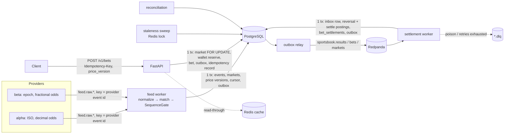

# bet-lifecycle-service

Бэкенд sportsbook, который проводит ставку через весь жизненный цикл: событие из фида → открытие рынка → приём ставки по версионированному коэффициенту → приостановка → расчёт → перерасчёт при исправлении результата → сверка. Сервис построен вокруг гарантий, которые важны для денег: at-least-once доставка при exactly-once бизнес-эффекте, double-entry ledger без поля `balance` и неизменяемая история.

**Стек:** Python 3.12, FastAPI, Pydantic v2, SQLAlchemy 2 (Core, async), PostgreSQL (SQLite для тестов и локального режима), Kafka через Redpanda + aiokafka, Redis, Prometheus, pytest + Hypothesis, uv, ruff, Docker Compose.

## Быстрый старт

### Без Docker (SQLite + in-memory брокер)

```bash
uv sync
uv run pytest                 # 130 тестов, 5 интеграционных пропускаются без сервисов
uv run bet-lifecycle demo     # весь жизненный цикл в одном процессе
```

Вывод `demo` (сокращён, суммы в центах):

```
2. feed: alpha created ev_3344a5a145eb; beta 'MAN UTD v SPURS' matched to ev_3344a5a145eb (same=True); beta prices ignored (alpha is primary)
3. bets accepted: p1 1x2/home 20.00 @ 2.1; p2 AH-0.25/home 30.00 @ 1.95; p2 O2.5 30.00 @ 1.9 (cash 2000, bonus 1000)
   retry with same Idempotency-Key -> replayed=True, same bet=True
4. odds moved; bet at price_version=1 -> requote (current v2 @ 2)
5. goal reported by beta -> markets suspended; bet -> market_not_open (incident)
   fresh alpha prices -> reopened: open v3
6. result 1-1 settled: [('home', 'lost', 0), ('home', 'half_lost', 1500), ('over', 'lost', 0)]
7. correction 2-1 resettled via reversal+new txn: [('home', 'won', 4200), ('home', 'won', 5850), ('over', 'won', 5700)]
8. all result messages redelivered -> balances unchanged: True
9. reconciliation: ok=True, bets=3, txns=15, mismatches=0
```

HTTP API в локальном режиме (outbox relay, settlement consumer и проверка устаревания фида работают внутри процесса API):

```bash
uv run bet-lifecycle api --port 8000
curl -X POST localhost:8000/v1/wallets/p1/deposits -H 'Idempotency-Key: dep-0001' \
     -H 'content-type: application/json' -d '{"amount": 10000}'
# фид: POST /v1/feed/alpha и /v1/feed/beta принимают сырые сообщения провайдеров
curl localhost:8000/v1/markets/<market_id>          # цена + price_version
curl -X POST localhost:8000/v1/bets -H 'Idempotency-Key: bet-0001' -H 'content-type: application/json' \
     -d '{"player_id":"p1","market_id":"<market_id>","selection":"home","stake":1000,"odds":"2.1","price_version":1}'
curl localhost:8000/v1/admin/reconciliation
curl localhost:8000/metrics
```

Нагрузочный тест (поднимает API на uvicorn со SQLite-файлом и параллельно двигает коэффициенты через фид):

```bash
uv run python scripts/load_test.py --bets 2000 --concurrency 8
```

### С Docker (PostgreSQL + Redpanda + Redis)

```bash
docker compose up --build -d                              # api, 4 воркера, postgres, redpanda, redis
docker compose --profile observability up -d prometheus   # Prometheus на :9090
uv run python scripts/feed_producer.py --bootstrap localhost:19092   # матч от двух провайдеров в Kafka
uv run pytest -m integration                              # тесты против живых сервисов
uv run python scripts/load_test.py --base-url http://localhost:8000
```

Compose и интеграционные тесты в этом окружении не запускались (Docker daemon недоступен); в CI для них есть отдельный job с service-контейнерами.

## Архитектура



Жизненный цикл ставки:

```mermaid
sequenceDiagram
    participant F as Feed (primary provider)
    participant S as Service
    participant P as Player
    F->>S: fixture + odds (seq 1..n)
    S->>S: market OPEN, price_version = 1
    P->>S: bet @ 2.10, price_version 1
    S-->>P: 201 (stake: player cash → house:escrow)
    F->>S: odds 2.00 → price_version 2
    P->>S: bet @ 2.10, price_version 1
    S-->>P: 409 requote (current v2 @ 2.00)
    F->>S: goal
    S->>S: all markets SUSPENDED (incident)
    F->>S: fresh odds → OPEN; status ENDED → CLOSED
    F->>S: result 1-1 (result_version 1) → SETTLED
    F->>S: correction 2-1 (result_version 2)
    S->>S: reversal of settle txn + new settle txn
    S->>S: reconciliation: bets = ledger = settlements
```

Состояния рынка: `suspended (новый) → open ⇄ suspended → closed → settled ⇄ voided`. Автоматически снимается только приостановка с причиной `incident` или `feed_stale` (свежей ценой от основного провайдера); `trader` снимает только трейдер.

### Код

```
src/bet_lifecycle/
  domain/          чистая логика без I/O: markets, ledger, settlement (grading), feed (SequenceGate), money
  feed/            адаптеры провайдеров alpha/beta, entity matching, симулятор
  messaging/       версионированные envelopes + upcaster, in-memory брокер, aiokafka
  application/     use cases: ingestion, bets/wallet, settlement, outbox relay, consumer (retry/DLQ), reconciliation
  infrastructure/  схема (SQLAlchemy Core), unit of work, репозитории, Redis cache/lock
  api/             FastAPI
```

Прикладной слой зависит от портов (`MessagePublisher`, `MessageSource`, `Cache`, `DistributedLock`, `Clock`); адаптеры подменяются in-memory реализациями, а база работает на SQLite в тестах и на PostgreSQL в compose.

## Ключевые решения

1. **Ledger без поля balance.** Баланс счёта равен сумме его проводок. Каждая транзакция проверяется в конструкторе: сумма проводок равна нулю, иначе `UnbalancedTransaction`. Счета: `player:{id}:cash`, `player:{id}:bonus`, `house:escrow` (открытые ставки), `house:revenue` (P&L), `external:payments` (контрсчёт депозитов). Ставка переносит stake из кошелька в escrow; расчёт выводит stake из escrow, выплата идёт в cash, возврат (void/push/половина ставки) возвращается в тот кошелёк, откуда пришёл, остаток — в revenue.
2. **Исправление результата = reversal + новая транзакция.** Таблицы `ledger_*`, `bet_settlements`, `market_prices`, `event_results`, `audit_log` только дополняются. `ledger_transactions.reverses` уникален, поэтому одну транзакцию нельзя сторнировать дважды. `bets.status/outcome/payout` — проекция текущего состояния для чтения; история лежит рядом.
3. **Exactly-once эффект при at-least-once доставке** держится на трёх уровнях. Первый — inbox: `(consumer, message_id)` вставляется в той же транзакции, что и проводки. Второй — версия результата: рынок помнит `settled_result_version`, более старая версия, пришедшая позже, игнорируется, поэтому итог не зависит от порядка доставки. Третий — идемпотентный grading: новая версия с тем же исходом не создаёт проводок.
4. **Версионированные цены и requote.** Каждое изменение цены увеличивает `price_version` и сохраняется в `market_prices`. Клиент присылает версию и коэффициент, которые видел. Проверка идёт под `SELECT ... FOR UPDATE` строки рынка, так что гонка с репрайсом или suspend невозможна. При расхождении — `409 requote` с текущей версией и ценой.
5. **Idempotency-Key.** Ответ сохраняется в `idempotency_keys` в той же транзакции, что и ставка, вместе с хешем тела запроса. Повтор возвращает сохранённый ответ с заголовком `Idempotent-Replayed: true`, тот же ключ с другим телом даёт 422. Одновременные дубли упираются в первичный ключ; проигравший получает `IntegrityError` и отдаёт сохранённый ответ. Депозиты идемпотентны через детерминированный id транзакции.
6. **Упорядочивание фида.** Каждое событие провайдера — отдельный поток с `seq`. `SequenceGate` отбрасывает дубли и старые сообщения, буферизует сообщения после разрыва и выдаёт их по порядку; если буфер переполнен, разрыв объявляется потерянным (метрика `feed_gaps_total`). Курсор `last_seq` хранится в БД и сдвигается в той же транзакции, что и изменения рынков. В Kafka ключ сообщения — id события провайдера, поэтому поток читает один consumer.
7. **Два провайдера.** Разные схемы нормализуются в одну каноническую модель. Команды сопоставляются по нормализованным названиям (регистр, диакритика, суффиксы FC/AFC, алиасы, fuzzy-сходство ≥ 0.85) и близости kickoff (±90 мин). Коэффициенты, статусы и результаты принимаются только от основного провайдера события. Если основной молчит дольше `failover_after`, основным становится тот, кто прислал сообщение (запись `primary_failover` в аудите). Инциденты (гол, красная) приостанавливают рынки от любого провайдера: здесь безопасность важнее.
8. **Transactional outbox.** События пишутся в `outbox` той же транзакцией. Relay публикует строки по порядку id и останавливается на первой строке в backoff, чтобы следующие события не обогнали её (этот баг нашёл тест). На PostgreSQL используется `FOR UPDATE SKIP LOCKED`. Producer идемпотентный, `acks=all`.
9. **Retry и DLQ на консьюмере.** Невосстановимые ошибки (битый envelope, неизвестная версия схемы, ошибка схемы провайдера, доменный отказ) сразу уходят в `<topic>.dlq` с заголовками `x-error`, `x-original-offset` и др. Временные ошибки повторяются с экспоненциальным backoff и jitter, после `max_attempts` сообщение тоже уходит в DLQ, чтобы партиция не встала. Offset коммитится только после коммита транзакции.
10. **Версионирование схем событий.** Envelope содержит `type` и `version`. `result.published` v1 (`score: "2-1"`, `abandoned: bool`) upcast'ится в v2 (`home_score`, `away_score`, `status`) до валидации. Версия новее известной считается poison и уходит в DLQ.
11. **Блокировки.** Бет-плейсмент берёт строку рынка, затем счета игрока в отсортированном порядке. Инжест и расчёт берут рынки события в порядке id, поэтому циклов ожидания нет. Redis-лок (`SET NX PX` + Lua-release по токену) используется только чтобы один экземпляр делал sweep устаревших фидов; деньги им не защищаются.
12. **Кеш только для отображения.** `GET /v1/markets/{id}` читает через Redis с TTL и инвалидацией после коммита (after-commit hook). Приём ставки всегда сверяет версию с БД.

## Failure modes по границам

| Граница | Что может пойти не так | Что делает сервис |
|---|---|---|
| Провайдер → feed worker | дубли, перестановки, пропуски `seq` | `SequenceGate` + курсор в БД; дубли отбрасываются, разрыв буферизуется, при переполнении пропускается с метрикой |
| | невалидный JSON / чужая схема | `FeedSchemaError` → DLQ без ретраев |
| | сообщение по событию, которое нельзя сопоставить | отказ в SAVEPOINT, запись в аудит, поток продолжает двигаться |
| | основной провайдер замолчал | sweep ставит `suspended(feed_stale)`; следующий провайдер становится основным, свежая цена открывает рынок |
| | гол, цена ещё старая | инцидент от любого провайдера → `suspended(incident)` до новой цены |
| Клиент → API | повтор запроса после таймаута | Idempotency-Key: тот же ответ, списание одно |
| | ставка по устаревшей цене | 409 requote с текущей версией |
| | гонка ставки с репрайсом/расчётом | row lock на рынке, проверка версии внутри транзакции |
| | одновременные ставки на весь баланс | lock счетов игрока; тест: 12 параллельных ставок на 50.00, принято ровно 5 |
| API/воркер → БД | падение посреди транзакции | всё (ставка, проводки, outbox, idempotency, inbox) в одной транзакции |
| БД → Kafka (outbox) | брокер недоступен | строка остаётся pending, backoff, порядок сохраняется; алерт `OutboxBacklog` |
| | падение после publish, до отметки | повторная публикация; консьюмеры дедуплицируют по `message_id` |
| Kafka → settlement | повторная доставка / ребаланс | inbox по `message_id` → no-op |
| | старый результат пришёл после нового | `settled_result_version` → рынок пропускается |
| | producer всё ещё пишет v1 | upcaster v1 → v2 |
| | poison / исчерпаны ретраи | DLQ + commit; алерт `MessagesDeadLettered` |
| Settlement → ledger | исправление результата | reversal + новая транзакция; игрок может уйти в минус, если уже вывел выигрыш |
| Всё вместе | рассинхрон проекций и денег | reconciliation: небалансовые транзакции, escrow vs открытые ставки, резерв vs stake, проводки расчёта vs выплата, grading по последнему результату, неприменённые исправления |

## Наблюдаемость

Prometheus (`/metrics` у API; воркеры отдают метрики на `BLS_METRICS_PORT`):

- `bet_placement_seconds` — histogram; p95/p99 как recording rules в `deploy/rules.yml`;
- `bets_total{result}` — accepted / replayed / requote / market_not_open / insufficient_funds / …;
- `consumer_lag_messages{consumer,topic,partition}`, `consumer_messages_total{result=ok|dlq}`, `inbox_duplicates_total`;
- `settlements_total{outcome}`, `resettlements_total`;
- `feed_messages_total{provider,result}`, `feed_gaps_total`, `market_suspensions_total{reason}`;
- `outbox_pending_messages`, `outbox_publish_failures_total`, `reconciliation_mismatches{kind}`.

Логи — JSON по строке на событие, с `request_id` из заголовка `X-Request-ID` (или сгенерированным).

## Тесты

`uv run pytest`: 130 тестов проходят, 5 интеграционных пропускаются без сервисов (около 40 с на Windows).

- **Unit (73):** таблицы grading для 1x2 / тоталов / азиатских фор, включая четвертные линии; ledger; state machine рынка; `SequenceGate`; нормализация провайдеров; matching; upcasting. Hypothesis проверяет: каждая транзакция балансируется, сумма всех счетов равна 0, escrow равен сумме открытых ставок, кошельки не уходят в минус при обычной работе, перерасчёт через любую цепочку исправлений даёт тот же баланс, что и расчёт сразу по итоговому исходу, стороны форы зеркальны, gate выдаёт каждый `seq` ровно один раз при любой перестановке с дублями.
- **Application (57, SQLite):** ingestion, ставки, расчёт и перерасчёт, outbox/consumer, сверка, HTTP API, demo.
- **Chaos-тест** (`tests/application/test_chaos.py`): 3 события, 12 ставок, 6 игроков с cash и bonus. Поток результатов включает два исправления, отмену матча задним числом и сообщение от producer'а на схеме v1. Каждое сообщение доставляется 2–5 раз в случайном порядке, консьюмер случайно «падает» до коммита offset'а и перечитывает сообщения; отдельный вариант запускает все обработчики конкурентно. Итоговые балансы всех счетов и исходы ставок совпадают с чистой однократной доставкой по порядку, сверка проходит, DLQ пуст.
- **Интеграционные** (`-m integration`): параллельные ставки и конкурентные дубли расчёта на PostgreSQL, round-trip через Redpanda с commit/lag, полный конвейер outbox → Kafka → settlement, Redis-лок и кеш. Пропускаются, если сервис недоступен.

### Нагрузочный тест (локальный режим)

`scripts/load_test.py`, 2000 ставок, 200 игроков, 15 рынков, репрайс каждые 0.5 с; Windows 11, Python 3.12, SQLite-файл, in-memory брокер. Задержка измеряется на клиенте для `POST /v1/bets`.

| concurrency | throughput | p50 | p95 | p99 | 201 / requote | reconciliation |
|---|---|---|---|---|---|---|
| 1 | 26.6 rps | 27 ms | 51 ms | 95 ms | 2000 / 8 | ok |
| 8 | 27.0 rps | 246 ms | 339 ms | 385 ms | 2000 / 56 | ok |
| 32 | 24.7 rps | 1046 ms | 1271 ms | 1333 ms | 1993 / 83 | ok |

Потолок около 27 rps задаёт единственный writer SQLite: все пишущие транзакции (ставки, фид, relay) сериализуются, поэтому с ростом concurrency растёт только очередь. Сама ставка — около 14 SQL-запросов, и на Windows aiosqlite тратит примерно 1.5 мс на переход между потоками для каждого. Это цифры локального режима, а не оценка production-производительности. На PostgreSQL ставки на разные рынки и разных игроков не блокируют друг друга; эти замеры здесь не делались, потому что Docker недоступен.

## Ограничения

- Нет аутентификации: `player_id` приходит в теле запроса, admin-эндпоинты открыты.
- Нет миграций (Alembic): схема создаётся через `metadata.create_all` (`bet-lifecycle init-db`).
- Буфер `SequenceGate` живёт в памяти процесса. При рестарте буферизованные сообщения, offset'ы которых уже закоммичены, теряются и становятся разрывом. Курсор при этом не откатывается, дубли не проходят.
- Сопоставление событий не сериализовано между воркерами: если первые сообщения двух провайдеров по одному матчу придут одновременно в разные партиции, можно получить два канонических события. Нужны advisory lock или отдельный merge.
- Результат берётся от одного основного провайдера, консенсуса между провайдерами нет.
- Только одиночные ставки: нет экспрессов, cash-out, лимитов по exposure рынка и игрока, responsible-gaming ограничений.
- Кеш и lock в Redis — best effort; lock не fencing-token, поэтому он не защищает денежные операции.
- Перерасчёт может увести баланс игрока в минус, если выигрыш уже выведен; политики взыскания долга нет.
- Relay с `SKIP LOCKED` в нескольких экземплярах сохраняет порядок только внутри батча одного экземпляра. Для строгого порядка по ключу нужен один relay на партицию или ключ.
- Compose-стек и интеграционные тесты написаны, но в этом окружении не запускались.

## Как это соотносится с вакансией

Вакансии sportsbook backend / sports feed / platform engineer описывают интеграцию нескольких feed-провайдеров, нормализацию событий, consumer lag в Kafka, кеширование в Redis, приостановку рынков и логику расчёта. Здесь всё это собрано в один работающий сервис:

- **Feed engineering:** два провайдера с разными схемами, entity matching, порядок и дедупликация по `seq`, failover основного провайдера, приостановка по инциденту и по устаревшему фиду.
- **Sportsbook core:** state machine рынков, версии цен и requote, приём ставок с Idempotency-Key, grading азиатских линий с half-won/half-lost.
- **Wallet / ledger:** double-entry, резервирование в escrow, возврат в источник средств, перерасчёт через сторно, сверка.
- **Platform:** transactional outbox, inbox, retry + DLQ, версионирование схем событий, метрики (latency p95/p99, consumer lag, DLQ), alert rules, Docker Compose с Redpanda/PostgreSQL/Redis, CI.
- **Темы интервью** (event ordering, idempotency, Kafka partitioning, consumer lag, cache invalidation, distributed locks, ledger, settlement corrections, schema evolution, observability): у каждой есть место в коде и тест.

Сервис не пересекается с [payments-service](https://github.com/nchekotko/payments-service) (RabbitMQ/FastStream, платежи): здесь Kafka и беттинговый домен.

## Лицензия

MIT, см. [LICENSE](LICENSE).
